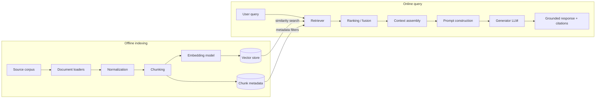
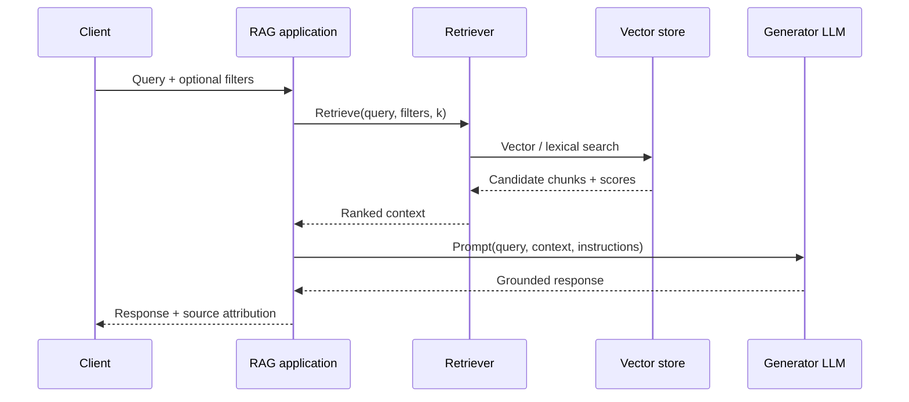

# RAG Engineering Reference

> A technical knowledge base for engineers designing, implementing, and operating Retrieval-Augmented Generation (RAG) systems. It documents architecture, components, runtime workflows, and production patterns, with small reference implementations for each stage.

---

## At a glance

| | |
| --- | --- |
| Subject | Retrieval-Augmented Generation (RAG) |
| Orientation | Engineering reference — concept-first, implementation-grounded |
| Audience | Software engineers, AI engineers, applied ML practitioners |
| Coverage | Corpus preparation · indexing · retrieval · context assembly · generation · observability · cost controls |
| Reference stack | Python 3.11+, LangChain, Chroma, FastEmbed; remote providers for generation |

> **Scope:** This repository is an engineering reference, not a deployed RAG service. It does not prescribe a single vendor stack.

## Contents

- [Reference architecture](#reference-architecture)
- [Runtime lifecycle](#runtime-lifecycle)
- [Terminology baseline](#terminology-baseline)
- [Reference map](#reference-map)
- [Run the reference code](#run-the-reference-code)
- [Boundaries](#boundaries)

## Reference architecture

A RAG system is split into an **offline indexing pipeline** that makes a corpus retrievable and an **online query pipeline** that turns a user query into a grounded response.



## Runtime lifecycle

The online path is a bounded sequence: retrieve, rank, assemble context, constrain generation, and attribute sources.



## Terminology baseline

The following terms are used consistently throughout this repository.

| Term | Meaning here |
| --- | --- |
| Corpus | Source material eligible for retrieval, represented as documents. |
| Chunk | Retrieval unit produced from a document; inherits source metadata. |
| Embedding | Vector representation of a chunk or query used for semantic similarity. |
| Vector store | Index that persists embeddings and supports similarity search with metadata filtering. |
| Retriever | Component that selects and ranks candidate chunks for a query. |
| Context | Ordered set of chunks injected into the generator prompt. |
| Grounded response | Answer constrained to the supplied context, with source attribution. |

## Reference map

Each area links to the current canonical implementation in this repository.

| Area | Engineering question | Reference implementation |
| --- | --- | --- |
| Ingestion & chunking | How does source material become retrievable units? | `document_loaders.py`, `chromadb/text_splitters.py` |
| Indexing & embeddings | How are chunks represented and stored? | `chromadb/app.py`, `chromadb/embeddings_deep.py` |
| Retrieval | How are relevant chunks selected and ranked? | `hybrid_retriever.py` |
| Generation | How is context converted into a grounded response? | `chromadb/rag_pipeline.py` |
| Observability | How are runs traced and inspected? | `langsmith_setup.py` |
| Cost & latency controls | How are model routing, caching, and token budgets handled? | `cost_optimization.py` |
| Tooling | How are versions and provider connectivity checked? | `src/rag/main.py`, `pyproject.toml`, `uv.lock` |

## Run the reference code

Install the locked environment from the repository root:

```bash
uv sync
```

Modules that call remote providers read credentials from a root-level `.env` file:

```dotenv
OPENAI_API_KEY=your_openai_key
ANTHROPIC_API_KEY=your_anthropic_key
```

`.env` is ignored by Git; never commit credentials. Run modules from the repository root, for example `uv run python chromadb/rag_pipeline.py`.

## Boundaries

- Reference corpora are embedded in scripts; there is no persistent ingest service.
- Indexes are in-memory or temporary; there is no serving layer or evaluation harness.
- Remote generation requires funded provider credentials; local embedding paths do not.
- Some modules still import deprecated `langchain-community` integrations.

---

Maintained as a living engineering reference. Contributions should follow the terminology baseline above and keep diagrams in Mermaid.
